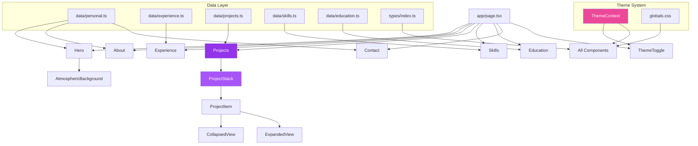

# akshat.dev

> **Disclaimer:** This code runs on vibes and prayers

Personal portfolio website built with Next.js, TypeScript, and Tailwind CSS.

## Getting Started

### Prerequisites

- Node.js 18+
- npm or yarn

### Installation

```bash
npm install
npm run dev
```

Open [http://localhost:3000](http://localhost:3000) in your browser.

### Build

```bash
npm run build
npm start
```

## Architecture


```
akshat.dev/
├── data/                   # All content data (single source of truth)
│   ├── personal.ts         # Name, bio, contact info, social links
│   ├── experience.ts        # Work experience
│   ├── education.ts        # Education and publications
│   ├── skills.ts           # Skills by category
│   ├── projects.ts         # Project details
│   └── index.ts            # Re-exports all data
├── types/                  # TypeScript interfaces
│   └── index.ts            # All type definitions
├── components/             # React components
│   ├── Hero.tsx            # Hero section with gradient text
│   ├── AtmosphericBackground.tsx # Aurora blobs with mouse tracking
│   ├── About.tsx           # About section with gradient cards
│   ├── Experience.tsx      # Timeline experience section
│   ├── Projects.tsx        # Stacked accordion project layout
│   ├── Skills.tsx          # Skills with gradient progress bars
│   ├── Education.tsx       # Education cards with gradient accents
│   ├── Contact.tsx          # Contact form with gradient buttons
│   ├── ThemeToggle.tsx     # Theme switcher
│   └── index.ts            # Component exports
├── contexts/               # React contexts
│   └── ThemeContext.tsx    # Dark/light theme state management
└── app/                    # Next.js app directory
    ├── layout.tsx          # Root layout
    ├── page.tsx            # Main page composition
    └── globals.css         # Global styles and CSS variables
```

### Architecture Diagram



## Advanced Components

### Atmospheric Background
The hero section features animated aurora blobs with interactive mouse tracking.

- **Aurora Blobs**: Four gradient blobs (purple, blue, pink, cyan) with blur effects that float and animate
- **Mouse Tracking**: Parallax movement using Framer Motion's `useMotionValue` and `useSpring` for smooth following
- **Dot Grid Pattern**: Animated grid that shifts with mouse movement
- **Cursor Spotlight**: Purple glow effect that follows the cursor position
- **Noise Texture**: Subtle grain overlay for texture
- **Radial Vignette**: Edge fade effect for depth

### Hero Section
- **Gradient Text**: Name uses purple→pink→blue gradient with `bg-clip-text`
- **Smooth Animations**: Floaty entrance with blur and scale effects (1.2s duration)
- **Gradient Buttons**: Primary button with purple→pink gradient, secondary with border
- **Scroll Indicator**: Animated arrow that pulses

### Section Components
All sections follow a consistent pattern:
- **Gradient Headers**: Section titles with purple→pink gradient text
- **Gradient Underlines**: Animated underline bars
- **Card Styling**: Rounded corners, soft shadows, gradient accents
- **Smooth Reveals**: Scroll-triggered animations with stagger

## Customization

### Updating Content

All content is in the `data/` directory. Edit these files to update your portfolio:

- **`data/personal.ts`** - Your name, title, bio, contact info, social links
- **`data/experience.ts`** - Work history with descriptions and technologies
- **`data/education.ts`** - Education, activities, coursework, publications
- **`data/skills.ts`** - Skills grouped by category with proficiency levels
- **`data/projects.ts`** - Featured projects with highlights and links

### Styling

- **Colors**: Edit CSS variables in `app/globals.css` for theme colors
- **Gradients**: Update gradient classes in components (e.g., `from-purple-600 to-pink-600`)
- **Animations**: Adjust animation variants in component files (duration, easing)

## Features

- ✨ **Purple/Pink Gradient Theme** - Cohesive color system throughout
- 🌓 **Dark/Light Theme Toggle** - Smooth transitions between themes
- 🎨 **Aurora Blob Background** - Animated gradient blobs with mouse interaction
- 📱 **Fully Responsive** - Works on all screen sizes
- 🎬 **Smooth Animations** - Floaty, soft animations with Framer Motion
- 📊 **Timeline Experience** - Visual timeline with gradient dots
- 📈 **Skill Progress Bars** - Animated progress bars with gradient fills
- 🎴 **Stacked Project Accordion** - Scroll-triggered accordion with click-to-expand
- 📝 **Contact Form** - Email form with gradient submit button
- 🔒 **Type-Safe** - Full TypeScript coverage

## Tech Stack

- **Next.js 14** - React framework with App Router
- **TypeScript** - Type safety and better DX
- **Tailwind CSS** - Utility-first styling
- **Framer Motion** - Smooth animations and interactions

## Project Structure

```
├── app/                    # Next.js app directory
│   ├── layout.tsx         # Root layout with theme provider
│   ├── page.tsx           # Main page composition
│   └── globals.css        # Global styles and CSS variables
├── components/            # React components
│   ├── Hero.tsx           # Hero section with gradient text
│   ├── AtmosphericBackground.tsx # Aurora blobs background
│   ├── About.tsx          # About section
│   ├── Experience.tsx     # Experience timeline
│   ├── Projects.tsx       # Projects grid
│   ├── Skills.tsx         # Skills with progress bars
│   ├── Education.tsx      # Education cards
│   ├── Contact.tsx        # Contact form
│   ├── ThemeToggle.tsx    # Theme switcher
│   └── index.ts           # Component exports
├── contexts/             # React contexts
│   └── ThemeContext.tsx  # Theme state management
├── data/                 # Content data (single source of truth)
│   ├── personal.ts        # Personal information
│   ├── experience.ts     # Work experience
│   ├── education.ts      # Education and publications
│   ├── skills.ts         # Skills by category
│   ├── projects.ts       # Project details
│   └── index.ts          # Data exports
├── types/                # TypeScript type definitions
│   └── index.ts          # All type interfaces
└── public/              # Static assets
```

## Development

### Running Locally

```bash
# Install dependencies
npm install

# Run development server
npm run dev

# Build for production
npm run build

# Start production server
npm start
```

### Code Style

- Components use TypeScript with strict typing
- Framer Motion for all animations
- Tailwind CSS for styling
- Data separated from presentation logic
- Consistent naming conventions

## License

MIT
