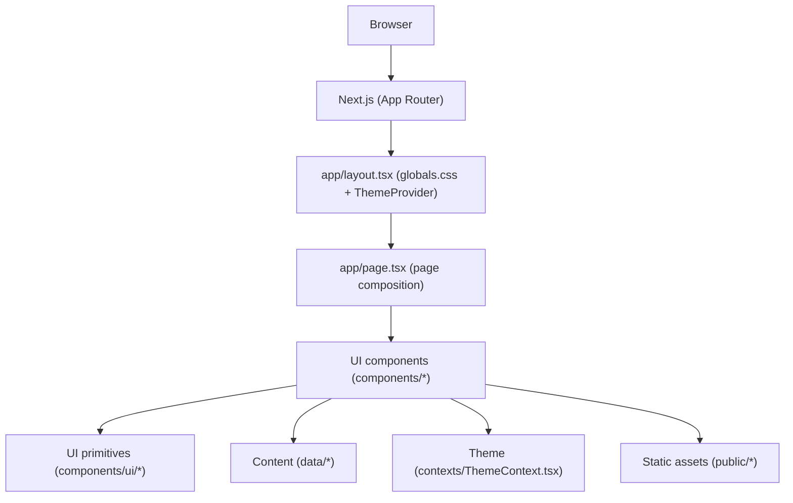

# portfolio

Personal portfolio site built with **Next.js (App Router)** + **TypeScript** + **Tailwind**. This repo is configured for **static export** (`output: "export"`), so the build output is the `out/` directory.

## Run locally

### Prereqs
- Node.js 18+

### Dev server

```bash
npm install
npm run dev
```

Open `http://localhost:3000`.

## Build (static export) + preview

```bash
npm run build
```

This generates `out/`. Preview it locally:

```bash
cd out
python3 -m http.server 3000
```

Then open `http://localhost:3000`.

## Architecture

### High-level setup
- **App shell**: `app/layout.tsx` imports `app/globals.css` and wraps the app in `ThemeProvider` (`contexts/ThemeContext.tsx`).
- **Page composition**: `app/page.tsx` renders `Navbar`, `Hero`, and section components wrapped in `Card` containers.
- **Content**: `data/*.ts` is the source of truth (personal info, experience, projects, etc.) consumed by section components.

### Project structure (key files)

```
akshatgurbuxani.github.io/
├── app/                    # Next.js App Router
│   ├── layout.tsx          # Root layout (ThemeProvider)
│   ├── page.tsx            # Main page composition
│   └── globals.css         # Global styles
├── components/             # React components (sections + shared)
│   ├── ui/                 # Reusable UI primitives
│   │   ├── icons/          # Icon components
│   │   ├── SectionHeader.tsx
│   │   └── index.ts
│   ├── Navbar.tsx          # Nav + integrated theme toggle
│   ├── Hero.tsx
│   ├── AtmosphericBackground.tsx
│   ├── About.tsx
│   ├── Experience.tsx
│   ├── Projects.tsx
│   ├── ProjectModal.tsx
│   ├── Education.tsx
│   ├── Contact.tsx
│   ├── Card.tsx
│   └── index.ts
├── contexts/
│   └── ThemeContext.tsx    # Theme state management
├── data/                   # Portfolio content (source of truth)
│   ├── personal.ts
│   ├── experience.ts
│   ├── projects.ts
│   ├── education.ts
│   └── index.ts
├── constants/              # App constants (paths, section IDs, etc.)
│   ├── app.ts
│   └── index.ts
├── types/
│   └── index.ts            # Shared TypeScript types
├── utils/
│   └── animations.ts       # Shared animation helpers
└── public/
    └── akshat_gurbuxani_resume.pdf
```

### Architecture diagram



### Important components
- **`components/Navbar.tsx`**: nav links, integrated theme toggle, clock, resume link.
- **`components/Hero.tsx`** + **`components/AtmosphericBackground.tsx`**: hero + animated background.
- **`components/Projects.tsx`** + **`components/ProjectModal.tsx`**: project grid + modal details.
- **`contexts/ThemeContext.tsx`**: theme state + toggling used by `Navbar` and global styles.

## Update content
- **`data/personal.ts`**: name/title/bio/social + nav links
- **`data/experience.ts`**: experience timeline
- **`data/projects.ts`**: project list + links
- **`data/education.ts`**: education

## Developer tools

### Animation control toggle

Heavy background animations are automatically disabled on mobile devices for better performance. Developers can override this behavior using localStorage:

**Disable animations:**
```javascript
localStorage.setItem("animations-enabled", "false")
```

**Enable animations:**
```javascript
localStorage.setItem("animations-enabled", "true")
```

**Reset to default (mobile=off, desktop=on):**
```javascript
localStorage.removeItem("animations-enabled")
```

Refresh the page after changing the setting. The toggle affects:
- Constellation canvas (particle system)
- 3D floating shapes
- Aurora blob animations
- Parallax grid effects
- Pointer trail

### Config override toggle

Override configuration values during development without modifying source files. Useful for testing different config values quickly.

**Override a config value:**
```javascript
localStorage.setItem("config-override", JSON.stringify({
  "SOCIAL_ICON_CONFIG.Email.gradient": "from-blue-500 to-cyan-500"
}))
```

**Override multiple values:**
```javascript
localStorage.setItem("config-override", JSON.stringify({
  "SOCIAL_ICON_CONFIG.Email.gradient": "from-blue-500 to-cyan-500",
  "SOCIAL_ICON_CONFIG.Email.label": "Send Email"
}))
```

**View current overrides:**
```javascript
JSON.parse(localStorage.getItem("config-override") || "{}")
```

**Clear all overrides:**
```javascript
localStorage.removeItem("config-override")
```

Refresh the page after setting overrides. See `utils/README.md` for more details and available config paths.

## License
MIT
