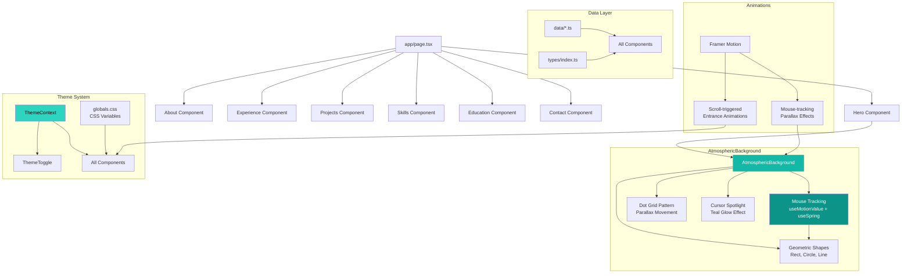

# akshat.dev

> **Disclaimer:** This code runs on vibes and prayers

Personal portfolio website built with Next.js, TypeScript, and Tailwind CSS.

## Getting Started

### Prerequisites

- Node.js 18+
- npm

### Installation

```bash
npm install
npm run dev
```

Open [http://localhost:3000](http://localhost:3000) in your browser.

### Build

```bash
npm run build
npm start
```

## Architecture

This project follows a clean architecture with complete separation of data from presentation, featuring a brutalist design aesthetic with geometric shapes and snappy animations.

```
akshat.dev/
├── data/                   # All content data (single source of truth)
│   ├── personal.ts         # Name, bio, contact info, social links
│   ├── experience.ts       # Work experience
│   ├── education.ts        # Education and publications
│   ├── skills.ts           # Skills by category
│   ├── projects.ts         # Project details
│   └── index.ts            # Re-exports all data
├── types/                  # TypeScript interfaces
│   └── index.ts            # All type definitions
├── components/             # React components
│   ├── Hero.tsx            # Hero section with brutalist styling
│   ├── AtmosphericBackground.tsx # Geometric shapes with mouse tracking
│   ├── About.tsx
│   ├── Experience.tsx
│   ├── Projects.tsx
│   ├── Skills.tsx
│   ├── Education.tsx
│   ├── Contact.tsx
│   ├── ThemeToggle.tsx
│   └── index.ts            # Component exports
├── contexts/               # React contexts
│   └── ThemeContext.tsx    # Dark/light theme state
└── app/                    # Next.js app directory
    ├── layout.tsx
    ├── page.tsx
    └── globals.css         # Brutalist theme variables
```

### Architecture Diagram



## Advanced Components

### Atmospheric Background
The hero section features a brutalist geometric background with interactive mouse tracking.
- **Geometric Shapes**: Rectangles, circles, and lines with subtle borders
- **Mouse Tracking**: Parallax movement using Framer Motion's `useMotionValue` and `useSpring`
- **Dot Grid Pattern**: Animated grid that responds to mouse movement
- **Cursor Spotlight**: Subtle teal glow that follows the cursor
- **Corner Accents**: Minimal geometric lines in corners for brutalist aesthetic

## Customization

### Updating Content

All content is in the `data/` directory. Edit these files to update your portfolio:

- **`data/personal.ts`** - Your name, title, bio, contact info
- **`data/experience.ts`** - Work history
- **`data/education.ts`** - Education and publications
- **`data/skills.ts`** - Skills grouped by category
- **`data/projects.ts`** - Featured projects

## Features

- Dark/light theme toggle with smooth transitions
- Fully responsive design
- Animated sections with Framer Motion
- Timeline-style experience section
- Skill progress bars with categories
- Project cards with hover effects
- Contact form
- Type-safe with TypeScript

## Tech Stack

- **Next.js 14** - React framework with App Router
- **TypeScript** - Type safety
- **Tailwind CSS** - Styling
- **Framer Motion** - Animations

## License

MIT
